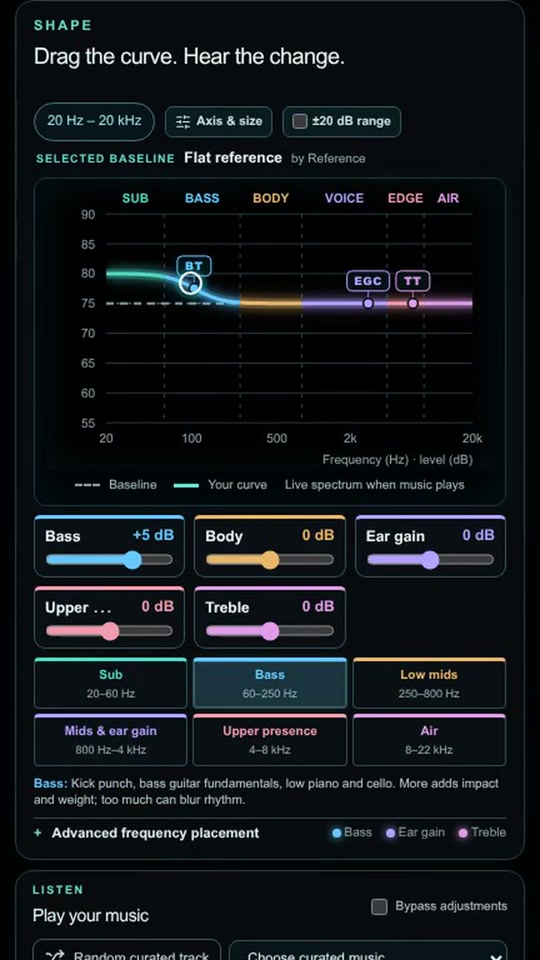

<div align="center">

# YinYang EQ League

### Shape it. Hear it. Find your sound.

A browser listening lab for headphone EQ: compare targets, shape your own curve, and take your EQ with you.

**[Explore the site](https://yinyangeq.com) · [Watch the demo](https://github.com/yinyangeqlab/yinyang-eq-league/releases/tag/demo-2026-10-17) · [Report a bug](https://github.com/yinyangeqlab/yinyang-eq-league/issues/new)**

[](LICENSE)
[](#made-with-gpt-codex)

[](https://github.com/yinyangeqlab/yinyang-eq-league/releases/tag/demo-2026-10-17)

**54.6 seconds · 1080p · real browser interaction**  
[Watch or download the cinematic trailer →]((retired demo))

</div>

## Mobile layouts supported!

Take a quick, casual tour of the phone layout: **45 seconds · vertical 9:16 · actual browser interactions**.

<a href="https://github.com/yinyangeqlab/yinyang-eq-league/releases/tag/mobile-layouts-2026-10-17"></a>

**[Watch or download the mobile walkthrough →]((retired demo))**

A brief look at Welcome, Shootout, Rankings, Song suggestions, Upload target, Measurements, My results, Music library, and Preference Tuning. [Video and music credits](docs/MOBILE_DEMO.md).

## Hear the difference

What happens when the same song meets two different headphone targets? YinYang EQ League lets you switch between them, listen, and choose **A**, **B**, or **Unknown / Tie**. Start with a headphone measurement so each target can be fitted to your headphones.


*One track, two target EQs. Switch sides during playback, hide or reveal curves in open mode, and add optional listening notes.*

| Mode | How it works | Where choices go |
| --- | --- | --- |
| **Random music · Blind Ranked** | Listen to a curated stereo track with target names hidden until your choice. | Eligible A/B votes enter the random-music ranking. |
| **Bring your music · Blind Ranked** | Compare hidden targets using your own stereo song. | Eligible A/B votes enter the bring-your-music ranking. |
| **Open comparison · Unranked** | Choose named targets and explore freely. | Personal results and private owner research; public rankings stay blind. |

Blind tests require **at least five seconds on each side** before the voting buttons unlock. Unknown/tie answers and same-filter checks do not change target rankings. Accepted decisive repeats count with reduced evidence weight per browser and target pair. Rankings are exploratory listener preferences, and depend on the headphones, measurement, music, and listener.

## Make the curve yours

Start from a reference, then adjust bass, body, ear gain, upper presence, and treble. Drag the curve or use the sliders, listen to the change, and bypass your adjustments to compare. When you are ready, generate EQ fits and download your target or preset.


*From a reference curve to your preference: the screenshot shows a +7.5 dB bass adjustment. It is a demo setting, not a recommended tuning.*

## Give your music a listening room

Explore the live music library with stereo waveforms, source credits, and listening notes. Audition tracks, keep a shortlist, and apply a saved or generated EQ to supported audio previews. This source release omits cached waveforms and hosted soundtrack files; its playback differences are described below.


*Look for texture, impact, vocals, and detail. Track cards explain what to listen for and link back to the creators.*

You can also search creator-sourced headphone measurements, import your own response, work with paired left/right channels, try private targets, and revisit comparisons in **My results**. Local file playback is processed in the browser; consult the site's **Data collection & opt-out** notice for the comparison and feedback data that participation submits.

The screenshots and trailer show demo sessions captured on October 17, 2026. Target names, track availability, and counts can change. Media credits are in [docs/DEMO.md](docs/DEMO.md).

## Made with GPT Codex

**This project was vibe coded by Yin Yang EQ Lab with GPT Codex.** Yin Yang EQ Lab directed the project, reviewed its releases, and used Codex to help write and revise code and documentation. Third-party components and data keep their original credits and licenses.

The application uses **TypeScript, React, Next.js/Vinext, the Web Audio API, Cloudflare Workers, and D1**. The browser handles interactive curves and audio processing; the server stores shared records and serves the application.

## Run locally

Requires **Node.js 22.13 or newer**. For a fresh checkout:

```sh
npm ci
npm run setup:local
npm run dev
```

`setup:local` initializes a fresh **local D1 database** from the checked-in SQL files and creates ignored development secrets. It refuses to overwrite an existing database. Open the URL printed by the dev server (normally `http://localhost:5173`). No Cloudflare account or production credentials are needed for this preview. See [local setup](docs/LOCAL_SETUP.md) for existing databases, feature requirements, and production configuration. Use `npm run build` to build the application.

The tracked `.openai/hosting.json` and `wrangler.local.json` contain local binding placeholders only. The two historical `0012` migrations are distinct and both required. Existing databases through `0015` need `0016_measurement_file_chunks.sql` for original-file research contributions. Pushing source does not migrate or deploy a database.

This is a clean source release. Production data, credentials, deployment state, invitation-gate infrastructure, target seed curves, and audio files are excluded. The site builds without them; listening comparisons need target records, and music playback needs appropriate audio sources.

The [source handoff](docs/HANDOFF.md) records dated application checkpoints and this accuracy correction. The [target inventory](docs/TARGET_INVENTORY.md) lists the 41 live target names and category rules without distributing their curve data. Future additions require a clear redistribution license for the actual curve files.

The live site uses **owner-supplied album downloads** for 32 tracks from Jake Kaufman’s *Shantae: Half-Genie Hero OST*: **26 original FLAC files and six AAC files**. These are copies of the artist’s recordings. The 32 included tracks’ [individual Bandcamp pages](https://virt.bandcamp.com/album/shantae-half-genie-hero-ost) link to CC BY-NC-SA 4.0. “Title” and “Let’s Go Shopping” are marked all rights reserved and are excluded. The recordings retain their own licenses and are **not** covered by this repository’s Apache license.

Those audio files are omitted from GitHub. Here, `data/shantae-audio.json` is intentionally empty, so Shantae uses Bandcamp embeds **without the site’s EQ**. Other music entries include external audio URLs and creator/license links. `data/music-waveforms.json` is also empty: the library displays “Waveform unavailable” until a compatible cache is supplied. The live-site screenshots show the separately populated deployment.

The production site has an invitation gate supplied by separate deployment infrastructure. Configure equivalent access controls, D1 bindings, and secrets in your own hosting environment before deploying a public replacement.

## License and provenance

Copyright 2026 **Yin Yang EQ Lab (@yinyangeqlab)**. Original application code is licensed under [Apache License 2.0](LICENSE), permitting broad reuse, including commercial and closed-source reuse, with its required notices. See [NOTICE](NOTICE) and [THIRD_PARTY.md](THIRD_PARTY.md) for copied components, data sources, and their separate licenses.

The source includes references to PEQdB as a target creator and to its TXT preset format. **No PEQdB target curves, preset exports, or PEQdB application code are included.** Working-project target seed data is excluded from this public repository. The demo can show targets held in a separate database; a screenshot or video does not grant rights to the underlying target data. Music keeps its own license and attribution, including the trailer soundtrack described in [the demo credits](docs/DEMO.md).

## Bugs, ideas, and contact

Found something broken, have a listening idea, or want to ask about the project? **[Open a GitHub issue](https://github.com/yinyangeqlab/yinyang-eq-league/issues/new)**. For a bug, include your browser/device, the page or mode, what you expected, and what happened. Keep tokens and personal files out of public reports.

You can also reach Yin Yang EQ Lab at **[yinyangeqlab@gmail.com](mailto:yinyangeqlab@gmail.com)**.

<details>
<summary><strong>Before pushing source changes</strong></summary>

Stage changes with Git and run `npm run check:release`. Review `git diff --cached --name-only` and each new file's redistribution rights. Never add `.env*`, local tokens, the working database, `infra/pulumi/Pulumi.*.yaml`, `public/music/`, `.sites-checkout/`, or build output.

</details>

## Track local updates

See [the local change notes and sync workflow](docs/LOCAL_CHANGES.md) for the October 17 application checkpoint, database requirement, verification, release exclusions, and how to bring future working-folder edits into this Git checkout.
