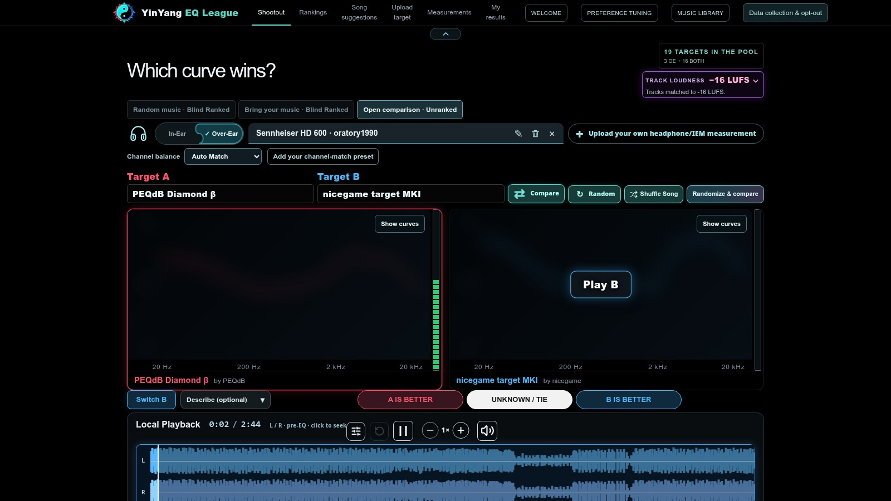
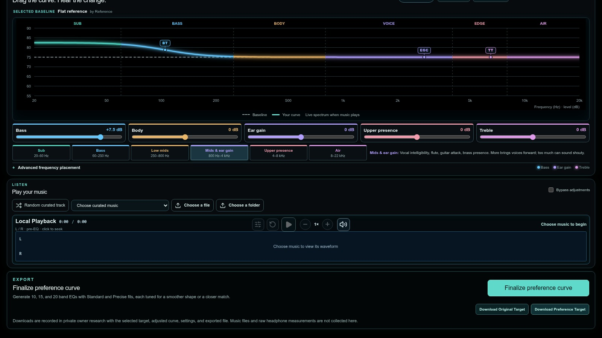
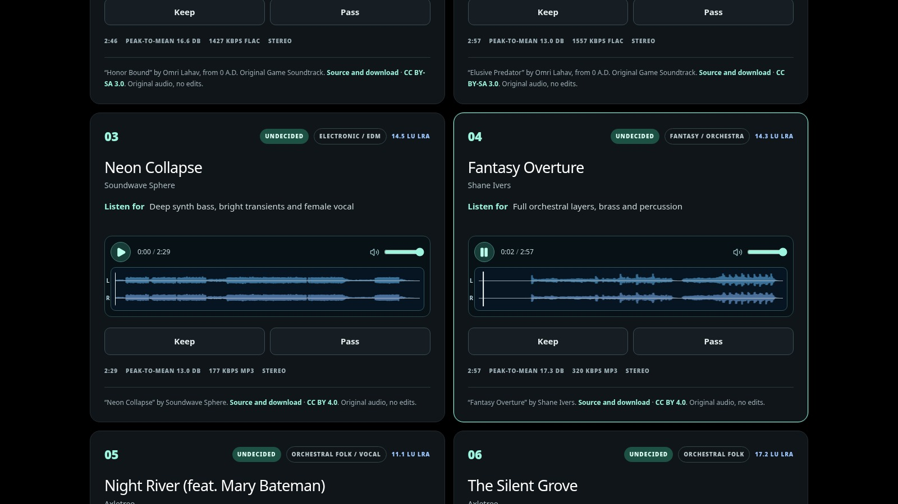

<div align="center">

# YinYang EQ League

### Find your sound. Let your ears decide.

A browser listening lab for headphone EQ: find your personal favorite targets, contribute blind comparisons, and shape your own curve.

**[Explore the site](https://yinyangeq.com) · [Watch the demo](https://github.com/yinyangeqlab/yinyang-eq-league/releases/tag/demo-2026-10-17) · [Report a bug](https://github.com/yinyangeqlab/yinyang-eq-league/issues/new)**

[](LICENSE_SCOPE.md)
[](#made-with-gpt-codex)

</div>

https://github.com/user-attachments/assets/a2e7a979-1a78-453f-836a-da6df3ad8a12

<div align="center">

**54.6 seconds · 1080p · real browser interaction**  
[Watch or download the cinematic trailer →](https://github.com/yinyangeqlab/yinyang-eq-league/releases/download/demo-2026-10-17/yinyang-eq-league-cinematic-trailer-v3.mp4)

</div>

## Desktop and mobile layouts

Take a quick, casual tour of the phone layout: **45 seconds · vertical 9:16 · actual browser interactions**.

https://github.com/user-attachments/assets/3502a781-9a84-45a2-8352-ff9a57ba0e49

**[Watch or download the mobile walkthrough →](https://github.com/yinyangeqlab/yinyang-eq-league/releases/download/mobile-layouts-2026-10-17/yinyang-eq-league-mobile-walkthrough.mp4)**

A historical look at the October 17 interface, including comparisons, measurements, the music library, and Preference Tuning. The current site also includes Personal Tournament, Research Rankings, Community Preferences, and optional account sync. [Video and music credits](docs/MOBILE_DEMO.md).

**[Copy video links for Discord →](docs/VIDEOS.md)** · [Watch both in the video gallery](https://github.com/yinyangeqlab/yinyang-eq-league/issues/2). Inline players use smaller streaming copies; the links above retain the 1080p originals.

## Hear the difference

What happens when the same song meets two different headphone targets? YinYang EQ League lets you switch between them, listen, and choose **Prefer A**, **Prefer B**, or **Unsure / Tie**. Start with a headphone measurement so each target can be fitted to your headphones.



*One track, two target EQs. Switch sides during playback, hide or reveal curves in open mode, and add optional listening notes.*

| Mode | How it works | Where choices go |
| --- | --- | --- |
| **Personal Tournament** | Narrow your favorites in an adaptive blind tournament, then recheck finalists with different music. Save progress and return later. | Choices stay in this browser by default. Personal research sharing and private account sync are separate optional choices. |
| **Blind Research · Listening Pool** | Compare hidden targets using a site-selected stereo track. | Eligible comparisons contribute to Combined Research Rankings and the Listening Pool source filter. |
| **Blind Research · Bring Your Own** | Compare hidden targets using a stereo song from your device. | Eligible comparisons contribute to Combined Research Rankings and the Bring Your Own source filter. Audio stays on your device; sharing song details is optional. |
| **Open Comparison · Unranked** | Choose named targets and explore freely, including your private curves. | Approved-target comparisons can enter private admin research under the participation agreement. Comparisons involving private targets stay local. Neither enters public Research Rankings. |

Controlled blind comparisons require **five matched seconds on each side of the same passage** before voting unlocks. Use the passage controls to compare the same section through both targets. Free-listening comparisons remain separate from controlled ranking evidence. Eligible ties count as half a preference for each target; identical-EQ checks remain diagnostic and do not affect target rankings. Research Rankings use participant-balanced evidence and describe exploratory preferences, which depend on the headphones, measurement, music, and listener.

**Community Preferences** is a separate optional validation pilot using future Personal choices and randomized reference checks. Its public numerical summaries remain withheld pending independent listener validation and privacy review. It is not another name for Research Rankings, and listeners do not receive a skill rank.

## Make the curve yours

Start from a reference, then adjust bass, body, ear gain, upper presence, and treble. Drag the curve or use the sliders, listen to the change, and bypass your adjustments to compare. When you are ready, generate EQ fits and download your target or preset.



*From a reference curve to your preference: the screenshot shows a +7.5 dB bass adjustment. It is a demo setting, not a recommended tuning.*

## Give your music a listening room

Explore the **Listening Pool** with stereo waveforms, source credits, and listening notes. Audition tracks, rate songs with Upvote or Downvote, and apply a saved or generated EQ to supported audio previews. Song ratings are separate from target preferences and do not remove eligible songs from the comparison pool. This source release omits cached waveforms and hosted recordings; its playback differences are described below.



*The October 17 screenshot shows an earlier library layout and earlier Keep/Pass labels. The current Listening Pool uses song-rating controls and groups alternate masters by song.*

You can also search creator-sourced headphone measurements, import your own response, work with paired left/right channels, try private targets, and revisit saved results.

## Participation and your data

The deployed listening tools require an affirmative comparison-data participation agreement. Optional choices cover identifiable activity monitoring, tags and fingerprints from your own music, Personal research sharing, and private account sync. Review them in **Your data choices**; change or withdraw them in **My data**. Declining optional sharing still allows listening under the required agreement. Withdrawal stops future participation and listening-tool access; deleting earlier submissions is a separate action.

Preference Tuning downloads are recorded for private admin research, including the exported file, curve and tuning settings. Original measurement files are contributed only after specific file and rights approval. Audio selected from your device is processed locally and is not uploaded by ordinary listening or sync. See the live [privacy notice](https://yinyangeq.com/privacy) for collection, retention and deletion details.

Optional **private account sync** keeps saved results, measurements, custom targets, EQs, progress, settings and saved music metadata on the server and browsers you explicitly approve. It excludes music/audio bytes, credentials, active playback and admin tests. Select local music again on each browser. Manage devices and conflicts in Sync settings; enabling sync does not grant research sharing or publish a profile.

The screenshots and trailer show demo sessions captured on October 17, 2026. Target names, track availability, and counts can change. Media credits are in [docs/DEMO.md](docs/DEMO.md).

## Made with GPT Codex

**This project was vibe coded by Yin Yang EQ Lab with GPT Codex.** Yin Yang EQ Lab directed the project, reviewed its releases, and used Codex to help write and revise code and documentation. Third-party components and data keep their original credits and licenses.

The application uses **TypeScript, React, Next.js/Vinext, the Web Audio API, Cloudflare Workers, and D1**. The browser handles interactive curves and audio processing; the server stores shared records and serves the application.

## Current release and rebuilding

The verified live release is recorded in [LIVE_RELEASE.json](LIVE_RELEASE.json) and [LIVE_STATE.md](LIVE_STATE.md). As of October 20, 2026, that is **update101**, including segmented optional account sync. Start development at [docs/HANDOFF.md](docs/HANDOFF.md) and [docs/RECOVERY.md](docs/RECOVERY.md); follow [docs/REBUILD.md](docs/REBUILD.md) for fresh-clone commands, private-input restoration and deployment boundaries. Historical handoffs and demos describe their own release dates. GitHub contains application and credential-free deployment code, not production recordings, curve seeds, credentials or database state.

## Run locally

Requires **Node.js 22.13 or newer**. For a fresh checkout:

```sh
npm ci
node scripts/check-live-source.mjs --source-only
npm run setup:local
npm run dev
```

`setup:local` initializes a fresh **local D1 database** from the checked-in SQL files and creates ignored development secrets. It refuses to overwrite an existing database. Open the URL printed by the dev server (normally `http://localhost:5173`). No Cloudflare account or production credentials are needed for this preview. See [local setup](docs/LOCAL_SETUP.md) for existing databases, feature requirements, and production configuration. Use `npm run build` followed by `node scripts/package-static-assets.mjs --public-only` for a public-clone preview package. Full live packaging requires authorized media and omits --public-only; deployment rejects public-only packages.

The tracked `.openai/hosting.json` and `wrangler.local.json` contain local binding placeholders only. A fresh local database needs all checked-in migrations, including both distinct historical `0012` files. For an existing database, inspect its migration history and follow the current rebuild instructions rather than replaying initialization. Recovery uses the pinned Node 26.12.0/npm 12.2.1 toolchain. Full `--snapshot` verification requires the owner's private immutable release inputs; those must not be published to make a public clone pass. Building, committing, pushing and deploying are separate operations.

This is a clean source release. Production data, credentials, deployment state, account-specific deployment configuration, target seed curves, and audio files are excluded. The site builds without them; listening comparisons need target records, and music playback needs appropriate audio sources.

The [source handoff](docs/HANDOFF.md) records dated application checkpoints and this accuracy correction. The [target inventory](docs/TARGET_INVENTORY.md) lists an earlier target-name inventory and category rules without distributing their curve data. Future additions require a clear redistribution license for the actual curve files.

The live site uses **owner-supplied album downloads** for 32 tracks from Jake Kaufman’s *Shantae: Half-Genie Hero OST*: **26 original FLAC files and six AAC files**. These are copies of the artist’s recordings. The 32 included tracks’ [individual Bandcamp pages](https://virt.bandcamp.com/album/shantae-half-genie-hero-ost) link to CC BY-NC-SA 4.0. “Title” and “Let’s Go Shopping” are marked all rights reserved and are excluded. The recordings retain their own licenses and are **not** covered by this repository’s Apache license.

The **live website plays those 26 FLAC and six AAC files with the site’s EQ and waveform data**. The audio files and live waveform cache are hosted separately and are **excluded from this GitHub repository**. Someone running this repository without supplying those assets gets Bandcamp players without the site’s EQ, because its `data/shantae-audio.json` is empty. Its `data/music-waveforms.json` is also empty, so library players display “Waveform unavailable” until a compatible cache is supplied. Other music entries include external audio URLs and creator/license links. The screenshots show the populated live-site configuration.

The production gate supports controlled invitation and open-listener access; the current setting is independent of the source release. Participation, protected-media access, ownership checks and abuse protections still apply. Configure equivalent controls, D1 bindings and secrets in your own hosting environment before deploying a replacement. Public-only preview packages must not be deployed.

## License and provenance

Copyright 2026 **Yin Yang EQ Lab (@yinyangeqlab)**. The [Apache License 2.0](LICENSE) covers only the original software source code; it permits broad reuse, including commercial and closed-source reuse, with its required notices. It does not grant rights to the YinYang EQ League or Yin Yang EQ Lab names, logos, marks, branded assets, site copy, screenshots, or visual design. Those rights are reserved unless a separate notice says otherwise. See [LICENSE_SCOPE.md](LICENSE_SCOPE.md), [NOTICE](NOTICE), and [THIRD_PARTY.md](THIRD_PARTY.md) for the detailed boundaries and other materials' licenses.

The source includes references to PEQdB as a target creator and to its TXT preset format. **No PEQdB target curves, preset exports, or PEQdB application code are included.** Working-project target seed data is excluded from this public repository. The demo can show targets held in a separate database; a screenshot or video does not grant rights to the underlying target data. Music keeps its own license and attribution, including the trailer soundtrack described in [the demo credits](docs/DEMO.md).

## Bugs, ideas, and contact

Found something broken, have a listening idea, or want to ask about the project? **[Open a GitHub issue](https://github.com/yinyangeqlab/yinyang-eq-league/issues/new)**. For a bug, include your browser/device, the page or mode, what you expected, and what happened. Keep tokens and personal files out of public reports.

You can also reach Yin Yang EQ Lab at **[yinyangeqlab@gmail.com](mailto:yinyangeqlab@gmail.com)**.

<details>
<summary><strong>Before pushing source changes</strong></summary>

Stage changes with Git and run `npm run check:release`. Review `git diff --cached --name-only` and each new file's redistribution rights. Never add `.env*`, local tokens, the working database, `infra/pulumi/Pulumi.*.yaml`, `public/music/`, `.sites-checkout/`, or build output.

</details>

## Track local updates

Use [the current handoff](docs/HANDOFF.md) for active work and release boundaries. [Local change notes](docs/LOCAL_CHANGES.md) retain the historical October 17 checkpoint.
