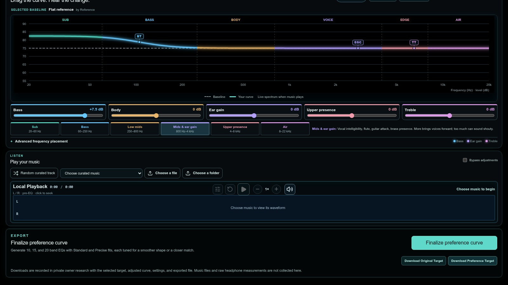

# YinYang EQ

[Android Companion and App Manager](https://yinyangeq.com/q5k4android) · [Watch the trailer](https://yinyangeq.com/q5k4android/trailer/portrait) · [Update186 release](https://github.com/yinyangeqlab/yinyang-eq-lab/releases/tag/update186)

[Website version history](https://yinyangeq.com/version#update186) · [Release source](https://github.com/yinyangeqlab/yinyang-eq-lab/tree/update186) · [Recovery verification](docs/releases/update186-recovery-verification.json)

YinYang EQ is a free, noncommercial browser lab for headphone equalization (EQ). Compare two sound profiles on your own headphones, find targets you prefer, or shape a curve and export an EQ preset. You can also contribute to an exploratory study of how consistent listeners are and where their preferences differ.

**[Try YinYang EQ](https://yinyangeq.com) · [Help & hotkeys](https://yinyangeq.com/shortcuts) · [Glossary & Guides](https://yinyangeq.com/glossary)**

## Start listening

Play the 12-second sample on the [homepage](https://yinyangeq.com) and switch between Sound A and Sound B. To build your own EQ ranking, open [Personal Tournament](https://yinyangeq.com/shootout/personal), choose a measurement for your headphone or in-ear monitor (IEM), and select a track. The app fits each target curve to that measurement so you can hear it through your headphones. Play the same passage on A and B, then pick the one you prefer or choose **Unsure / Tie**.

| Mode | What you can do |
| --- | --- |
| **Personal Tournament** | Narrow a field of hidden targets to your favorites and recheck finalists with different music. Save your progress and come back later. |
| **Blind Research** | Compare randomly assigned targets using a track from the Listening Pool or a stereo file from your device. Eligible comparisons contribute to Research Rankings. |
| **Open Comparison** | Pick two named targets, including your own curves, and listen freely. |
| **Blind EQ Comparison** | Compare two presets you supply across a playlist, then reveal and download your results. Each song gets its own randomized A/B assignment. You can start without a headphone measurement. [How it works](docs/guides/BLIND_EQ_COMPARISON.md) |
| **Preference Tuning** | Start from a reference, adjust bass through treble while you listen, and export a target curve or EQ preset. |
| **Shareable Shootouts** | Create a blind comparison with two to four eligible targets, then share a link or embed it. [How sharing works](docs/guides/SHAREABLE_SHOOTOUTS.md) |



*Preference Tuning in an earlier interface. The curve shown is an example.*

## Research and rankings

Controlled Blind Research trials hide target names and randomize A/B order. To unlock voting, listen to at least five seconds of the same passage on each side. Eligible ties count as half a preference for each target. The app normalizes source audio and uses shared playback gain and headroom. Applying EQ can still change perceived loudness.

Research Rankings use a participant-balanced, regularized Bradley–Terry score. Each participant group has a fixed total weight across the pairs it heard. The rankings describe preferences in a self-selected sample under varied listening conditions. Rapid Shootout has a separate Free Listening ranking and lets you vote without a playback minimum. Community Preferences is a separate opt-in pilot using shared Personal Tournament choices and randomized reference checks. [Research protocol](docs/research/RESEARCH_PROTOCOL.md) · [Research questions and analysis plans](docs/research/README.md) · [Community validation protocol](docs/research/COMMUNITY_VALIDATION_PROTOCOL_2026-10-19.md)

## Participation and privacy

The main listening tools require a participation agreement before their first data-recording action. Personal Tournament choices stay in your browser by default. Eligible Blind Research submissions can affect public rankings, while Open Comparison submissions using approved targets are available for private research. Open comparisons involving private targets stay local.

Audio files you select from your device stay on that device during ordinary listening and Sync. In the private Blind EQ Comparison tool, presets and results stay in the tab. Preference Tuning exports made under the participation agreement are recorded for private research, including the exported file and tuning settings.

Research sharing from Personal Tournament, song tags and fingerprints, activity monitoring, and account Sync each have their own opt-in. You can change those choices or delete earlier submissions in **My data**. [Manage your data](https://yinyangeq.com/my-data) · [Privacy notice](https://yinyangeq.com/privacy)

## EQ fitters

YinYang EQ offers fixed-band and movable-band fitters and integrates the open-source PEQdB AutoEQ optimizer. The benchmark compares RMS curve-fit error and peak boost across 14 cases. These metrics describe how closely a preset follows a target and how much headroom it needs. Listening preferences are measured separately. [EQ fitter benchmark](https://yinyangeq.com/glossary/eq-fitting) · [Per-case scores (CSV)](public/eq-fitting/eq-fitter-scores.csv)

## Run locally

Use the Node and npm versions pinned in `.nvmrc` and `package.json`.

```sh
npm run recovery:environment
npm ci
node scripts/check-live-source.mjs --source-only
npm run setup:local
npm run dev
```

Open the URL printed by the dev server, usually `http://localhost:5173`. Setup creates a fresh local D1 database from the checked-in migrations. The public clone includes application code, music catalog metadata, and credential-free deployment configuration. Supply authorized target records and audio files to use target comparisons and play the hosted catalog locally. Public-only builds are for local previews. [Local setup](docs/LOCAL_SETUP.md) · [Build and verification guide](docs/REBUILD.md) · [Documentation index](docs/README.md)

## License and credits

Copyright © 2026 Yin Yang EQ Lab. The original software is licensed under Apache 2.0. Branding, site copy, screenshots, visual design, music, target curves, measurements, and datasets are outside that grant. Third-party components and materials retain their own licenses, including PEQdB AutoEQ under LGPL-3.0-or-later. [Apache 2.0 license](LICENSE) · [License scope](LICENSE_SCOPE.md) · [Notices](docs/legal/NOTICE) · [Third-party credits](THIRD_PARTY.md)

Track cards credit the artists and link to available sources and licenses. The library includes Creative Commons recordings and recordings used with the artist’s permission. [Target credits](docs/research/TARGET_INVENTORY.md) · [Permission for Jason J. Chevallier recordings](docs/media/JASON_MUSIC_IMPORT_2026-10-23.md) · [Media credits](docs/media/VIDEOS.md)

Development assisted by OpenAI Codex and Anthropic Claude.

## Feedback

For a bug report, include your browser and device, the page or mode, and the steps that reproduced the issue. Keep private links, access codes, and personal files out of public reports. [Open an issue](https://github.com/yinyangeqlab/yinyang-eq-lab/issues/new) · [Email Yin Yang EQ Lab](mailto:yinyangeqlab@gmail.com)
